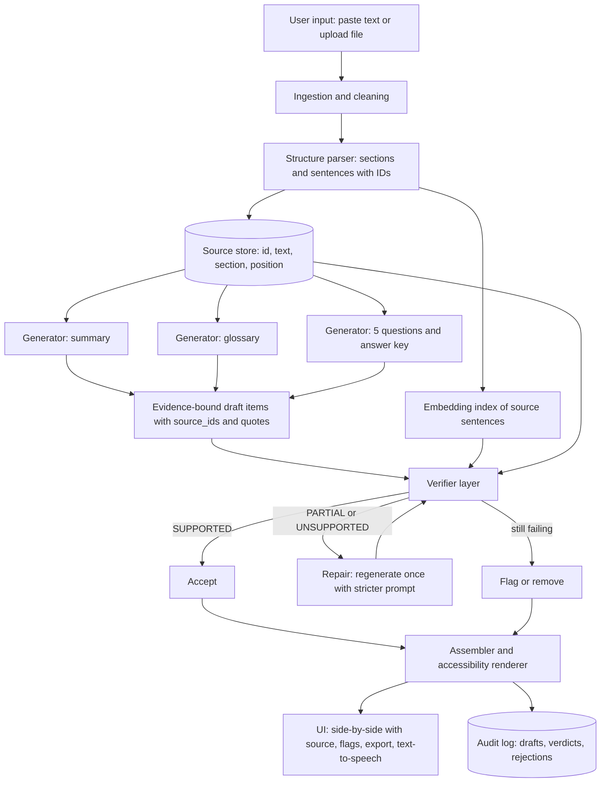

# Question 9: Accessible Lecture Notes and Summaries

**Project title:** *NoteBridge*, a source-grounded study-aid generator
**One-line pitch:** Turn instructor-approved lecture notes into a summary, a glossary, and five practice questions, where every generated sentence is tied to the exact source passage it came from, and anything the source cannot support is flagged instead of silently included.

---

## 1. Understanding the Problem

### 1.1 Who is this for?
- Students who **missed a lecture** and need to catch up quickly.
- Students who need a **more accessible format**: dyslexia, ADHD, low vision, non-native language speakers, or anyone who finds dense notes hard to read.
- **Instructors**, who want assurance that nothing was added or distorted before it reaches students.

### 1.2 The real challenge
Summarising text with an LLM is easy. The hard part is **trust**. A study aid that confidently adds one wrong fact is worse than no study aid, because the student has no way to tell the wrong fact from the right ones. The core design principle is therefore:

> **The model may only restate, compress, or ask about what is in the source. Every output item must carry evidence, and anything without evidence is flagged or removed.**

### 1.3 Requirement mapping

| Requirement from the brief | How NoteBridge satisfies it |
|---|---|
| User can supply text or a sample document | Paste box, file upload (`.txt`, `.md`, `.pdf`, `.docx`), and a built-in sample lecture |
| Generate a summary | Concise bullet summary, each bullet cited to source sentence IDs |
| Key-term definitions | Glossary extracted from the notes, with definitions built from the source wording |
| Five questions with an answer key | Five questions of mixed type, each with an answer and the source passage that proves it |
| Show source passage for each generated item | Every item has `source_ids` plus the quoted passage, shown beside it in the UI |
| Flag content the source cannot support | A verification layer assigns each item a status (`SUPPORTED`, `PARTIAL`, `UNSUPPORTED`, `CONTRADICTED`) and unsupported items are blocked or flagged |
| Prototype with one complete sample I/O | Section 6 |
| Factual review checklist | Section 7 |
| Plan to reduce unsupported statements | Section 8 |

---

## 2. Approach in Brief

NoteBridge follows a **"segment, generate with evidence, verify, then show"** pipeline instead of a single "summarise this" prompt.

1. **Segment** the notes into numbered sections and sentences, giving each a stable ID such as `S2.4`.
2. **Generate** each artefact (summary, glossary, questions) with a prompt that *requires* the model to return the IDs it relied on, plus a short supporting quote.
3. **Verify** every generated item independently of the generator: check that the quote really exists, check that the item is entailed by the cited passage, and check for numbers or named entities that appear nowhere in the source.
4. **Repair or flag.** Items that fail get regenerated once with stricter instructions. If they still fail, they are removed or shown with a visible warning.
5. **Present** everything in an accessible UI with the source passage side by side, and export to Markdown, PDF, or audio.

This is a **grounded generation + independent verification** design. The generator and the verifier are deliberately separate so that the same mistake is unlikely to pass both.

---

## 3. System Design

### 3.1 High-level architecture



### 3.2 Components

| # | Component | Responsibility | Suggested tech |
|---|---|---|---|
| 1 | **Ingestion** | Accept text or file, extract plain text, normalise whitespace and bullets | Python, `pypdf`, `python-docx` |
| 2 | **Structure parser** | Split into sections (by headings) and sentences; assign IDs like `S2.4` | Regex + `spaCy` or `nltk` sentence splitter |
| 3 | **Source store** | Holds the canonical text per ID; the single source of truth | In-memory dict or SQLite |
| 4 | **Embedding index** | Lets the verifier find the best-matching source sentence for any claim | `sentence-transformers` + FAISS (or plain cosine for small notes) |
| 5 | **Generators** | Three prompts (summary, glossary, questions), all returning strict JSON with evidence | LLM API (Claude) with JSON output |
| 6 | **Verifier** | Four independent checks per item (see 3.4) | NLI model + rules + LLM judge |
| 7 | **Repair loop** | One regeneration attempt with the failure reason included | Same LLM, stricter prompt |
| 8 | **Assembler** | Merges accepted and flagged items into one document | Python |
| 9 | **UI** | Input, results, source highlighting, flags, export | Streamlit for the prototype; React + FastAPI for a production version |
| 10 | **Audit log** | Stores every draft and verdict for the review checklist and for evaluation | JSON lines / SQLite |

### 3.3 Data model

Source sentence:
```json
{ "id": "S3.4", "section": "3", "section_title": "Scheduling algorithms",
  "text": "SJF gives the minimum average waiting time ...", "position": 14 }
```

Generated item (the same envelope is used for summary points, glossary entries, and questions):
```json
{
  "item_id": "sum-2",
  "type": "summary_point",
  "text": "Waiting time is the total time a process spends in the ready queue.",
  "source_ids": ["S2.4"],
  "evidence_quote": "Waiting time is the total time a process spends in the ready queue.",
  "verdict": "SUPPORTED",
  "scores": { "quote_found": true, "entailment": 0.97, "novel_entities": [], "judge": "pass" },
  "flag_reason": null
}
```

Question item adds:
```json
{ "question": "...", "qtype": "mcq | short | true_false",
  "options": ["..."], "answer": "...", "answer_source_ids": ["S3.4"] }
```

### 3.4 The verification layer (the core of the project)

Every generated item passes four checks. Using several different kinds of check means a single weakness in one does not let an error through.

| Check | What it does | Catches |
|---|---|---|
| **1. Quote existence (deterministic)** | The `evidence_quote` must appear in the cited source sentence (exact or normalised match) | Invented citations, fabricated quotes |
| **2. Entailment (NLI model)** | Premise = cited source passage; hypothesis = generated statement. Score for *entails / neutral / contradicts* | Claims that go beyond or contradict the source |
| **3. Novel-fact scan (rules)** | Extract numbers, units, dates, proper nouns, and technical terms from the output; each must appear in the source (after normalisation) | Hallucinated statistics, names, and examples |
| **4. LLM judge (second pass)** | A separate prompt, given only the source and the claim, answers "Is every part of this claim stated or directly implied by the source? List any part that is not." | Subtle overreach, over-generalisation ("always", "all", "most") |

**Verdict rules**

| Verdict | Condition | Action |
|---|---|---|
| `SUPPORTED` | Quote found, entailment above threshold, no novel entities, judge passes | Show normally |
| `PARTIAL` | Entailment moderate, or the judge flags a minor extra detail | Repair once; if still partial, show with a yellow "check against source" flag |
| `UNSUPPORTED` | Neutral entailment or novel entities present | Repair once; if still failing, remove from output and list under "Removed items" |
| `CONTRADICTED` | NLI says contradiction | Always removed; logged for review |

Thresholds (for example entailment ≥ 0.85) are tuned on a small labelled set (see Section 9).

### 3.5 Prompt design principles

- **Closed-book instruction:** "Use only the numbered source sentences below. If the answer is not in them, output `INSUFFICIENT_SOURCE` instead of guessing."
- **Evidence-first output:** the JSON schema asks for `evidence_quote` and `source_ids` *before* the statement text, so the model commits to evidence first.
- **Wording discipline:** definitions must reuse the source's own terms; no outside examples, analogies, or "typically/usually/in practice" language.
- **Low temperature** (0 to 0.2) for all generation.
- **Question rules:** every question must be answerable from a single cited passage or two adjacent ones; distractors in MCQs must be plausible *but must not introduce new factual claims* (they should reuse source terms in the wrong role).

Example generator instruction (summary):
```text
You are summarising instructor-approved lecture notes for students.
RULES
1. Use ONLY the numbered source sentences provided.
2. Each summary point must be a faithful compression of one or more source
   sentences. Do not add facts, examples, numbers, or opinions.
3. For each point return: source_ids, evidence_quote (copied verbatim from
   the source), then the summary text.
4. Keep every point under 25 words; use plain language.
5. If the notes do not contain enough to write a point, return
   INSUFFICIENT_SOURCE rather than guessing.
Return valid JSON matching the schema.
```

### 3.6 Accessibility features (the "accessible format" half of the brief)

- **Plain-language mode:** shorter sentences and a reading-level target, while the verifier still checks meaning against the source.
- **Layout:** high-contrast theme, adjustable font size, a dyslexia-friendly font option, generous spacing.
- **Screen-reader friendly:** semantic headings, ARIA labels for flags, flags conveyed by *text and icon* (never colour alone).
- **Text-to-speech:** read the summary and glossary aloud; question mode can read a question and reveal the answer on request.
- **Chunked output:** collapsible sections so students can digest one part at a time.
- **Export:** Markdown, PDF, and plain text for use in other tools.

### 3.7 Deployment view

```
Browser (Streamlit / React)
        |
        v
API layer (FastAPI) ---- Auth (optional, instructor vs student roles)
        |
        +-- Pipeline workers (parse -> generate -> verify -> repair)
        |        |
        |        +-- LLM API   +-- NLI model   +-- Embedding model
        |
        +-- Storage: notes, outputs, audit logs (SQLite / Postgres)
```

For a classroom prototype the whole thing can run as a single Streamlit app with the verifier models running locally.

---

## 4. Handling Different Inputs

| Input case | Handling |
|---|---|
| Pasted text with headings | Headings become section boundaries |
| Plain text with no headings | Fall back to paragraph breaks, then fixed-size sentence groups |
| PDF / DOCX | Extract text; warn if extraction looks noisy (tables, equations, scans) |
| Very short notes (< ~10 sentences) | Fewer summary points; if five good questions are impossible, say so rather than padding with unsupported ones |
| Very long notes | Process section by section, then produce a section-level summary and a final roll-up |
| Tables, formulas, images | Prototype flags them as "not processed"; future work: OCR and table parsing |

---

## 5. Why this design beats a single prompt

| Single "summarise this" prompt | NoteBridge |
|---|---|
| No way to see where a sentence came from | Every item has a cited, quoted source |
| Errors look the same as correct statements | Errors are scored, flagged, or removed |
| Same model writes and checks its own work | Generator and verifier are independent |
| Output quality is anecdotal | Each run is logged and measurable |
| Cannot say "the notes don't cover this" | Explicit `INSUFFICIENT_SOURCE` path |

---

## 6. Complete Sample Input and Output

### 6.1 Sample input: instructor-approved notes (Lecture 7, CPU Scheduling Basics)

**Section 1: What is CPU scheduling?**
- `S1.1` CPU scheduling is the method an operating system uses to decide which process in the ready queue gets the CPU next.
- `S1.2` Its goal is to keep the CPU busy and to give users acceptable response times.
- `S1.3` The component that hands the CPU to the chosen process is called the dispatcher.
- `S1.4` The time the dispatcher takes to stop one process and start another is called dispatch latency.

**Section 2: Scheduling criteria**
- `S2.1` CPU utilization is the percentage of time the CPU is busy.
- `S2.2` Throughput is the number of processes completed per unit time.
- `S2.3` Turnaround time is the total time from submission of a process to its completion.
- `S2.4` Waiting time is the total time a process spends in the ready queue.
- `S2.5` Response time is the time from submission of a request until the first response is produced.

**Section 3: Scheduling algorithms**
- `S3.1` First-Come, First-Served (FCFS) schedules processes in the order they arrive.
- `S3.2` FCFS is non-preemptive and can cause the convoy effect, where short processes wait behind one long process.
- `S3.3` Shortest Job First (SJF) selects the process with the smallest next CPU burst.
- `S3.4` SJF gives the minimum average waiting time for a given set of processes, but the length of the next burst must be predicted.
- `S3.5` Round Robin (RR) gives each process a fixed time slice called the time quantum, after which the process is preempted and placed at the end of the ready queue.
- `S3.6` If the time quantum is very large, RR behaves like FCFS; if it is very small, context-switch overhead increases.

### 6.2 Output A: Summary (each point cited)

| # | Summary point | Source | Status |
|---|---|---|---|
| 1 | CPU scheduling is how the OS chooses which ready process runs next, aiming to keep the CPU busy and keep response times acceptable. | S1.1, S1.2 | ✅ Supported |
| 2 | The dispatcher gives the CPU to the chosen process; the time it takes to switch processes is dispatch latency. | S1.3, S1.4 | ✅ Supported |
| 3 | Schedulers are judged by CPU utilization, throughput, turnaround time, waiting time, and response time. | S2.1 to S2.5 | ✅ Supported |
| 4 | FCFS runs processes in arrival order but can cause the convoy effect, where short processes wait behind a long one. | S3.1, S3.2 | ✅ Supported |
| 5 | SJF minimises average waiting time but needs the next CPU burst length to be predicted. | S3.3, S3.4 | ✅ Supported |
| 6 | Round Robin gives each process a fixed time quantum and then moves it to the back of the queue; the quantum size trades off FCFS-like behaviour against context-switch overhead. | S3.5, S3.6 | ✅ Supported |

### 6.3 Output B: Glossary

| Term | Definition (from source wording) | Source | Status |
|---|---|---|---|
| Dispatcher | The component that hands the CPU to the chosen process. | S1.3 | ✅ Supported |
| Dispatch latency | The time the dispatcher takes to stop one process and start another. | S1.4 | ✅ Supported |
| Turnaround time | Total time from submission of a process to its completion. | S2.3 | ✅ Supported |
| Waiting time | Total time a process spends in the ready queue. | S2.4 | ✅ Supported |
| Response time | Time from submission of a request until the first response is produced. | S2.5 | ✅ Supported |
| Convoy effect | Short processes waiting behind one long process (seen in FCFS). | S3.2 | ✅ Supported |
| Time quantum | The fixed time slice each process gets in Round Robin. | S3.5 | ✅ Supported |
| Preemption | A process being stopped after its time slice and placed at the end of the ready queue. | S3.5 | ⚠️ **Partial**: the notes *use* "preempted" but never define it. The definition above is limited to what S3.5 describes; no general definition has been added. |

### 6.4 Output C: Five practice questions with answer key

| # | Type | Question | Answer | Source |
|---|---|---|---|---|
| 1 | Short answer | What is the role of the dispatcher? | It hands the CPU to the process chosen by the scheduler. | S1.3 |
| 2 | Short answer | How does *waiting time* differ from *turnaround time*? | Waiting time is the time spent in the ready queue; turnaround time is the total time from submission to completion. | S2.3, S2.4 |
| 3 | True / False | SJF gives the minimum average waiting time for a given set of processes. | **True**, but it requires the next burst length to be predicted. | S3.4 |
| 4 | Short answer | Why can FCFS cause the convoy effect? | Because it is non-preemptive, so short processes must wait behind one long process. | S3.2 |
| 5 | MCQ | In Round Robin, what happens if the time quantum is made very small? <br>A) RR behaves like FCFS <br>B) Context-switch overhead increases <br>C) Throughput becomes zero <br>D) Processes are never preempted | **B** | S3.6 |

*(Option D is a distractor that reuses source vocabulary in the wrong role, and option C is clearly incorrect without introducing any new factual claim.)*

### 6.5 Output D: Flags and removed items

The generator's first drafts contained statements the verifier did **not** let through:

| Draft statement | Check that failed | Verdict | Action |
|---|---|---|---|
| "Round Robin is the most widely used scheduler in modern operating systems." | No supporting source sentence; novel claim ("most widely used", "modern operating systems") | ❌ Unsupported | Removed from summary; listed here |
| "SJF is impossible to implement in practice." | NLI says it contradicts S3.4 (the notes only say the burst length must be *predicted*) | ❌ Contradicted | Removed; logged |
| Question draft: "What is a typical time quantum in milliseconds?" | Number and topic absent from the source; best match S3.6 gives no value | ❌ Unsupported | Question dropped; replaced by Question 5 |
| Glossary: "Preemption: forcibly taking the CPU away from a running process." | Quote found (S3.5) but definition goes beyond the source | ⚠️ Partial | Regenerated, narrowed to S3.5 wording, shown with "check against source" flag |

### 6.6 Run report

```
Source sentences: 15   Sections: 3
Items generated: 20 (6 summary, 8 glossary, 5 questions, 1 extra draft)
Accepted (SUPPORTED): 18   Partial (flagged): 1   Removed: 3
Support rate after verification: 100% of shown items traced to source
```

---

## 7. Factual Review Checklist

Used by a human reviewer (the instructor or a teaching assistant) on every output set. The same list drives the automated tests.

### 7.1 Per-item checks
- [ ] **Traceable:** the item cites at least one source ID and the quoted passage really exists in the notes.
- [ ] **Faithful:** the item says no more and no less than the cited passage supports.
- [ ] **No new facts:** no numbers, dates, names, formulas, or examples that are absent from the notes.
- [ ] **No distortion:** modality and scope are preserved (words such as *can*, *may*, *always*, *minimum*, *only*, *most* are unchanged in meaning).
- [ ] **Terminology intact:** technical terms match the notes' wording and spelling.
- [ ] **Definitions complete but not extended:** glossary entries match how the notes define the term; any term the notes use but never define is flagged.

### 7.2 Summary checks
- [ ] Covers every section of the notes at least once.
- [ ] Preserves the relationships (cause and effect, comparison, ordering) stated in the notes.
- [ ] No point repeats another; no important heading is missing.
- [ ] Contains no opinion or recommendation not in the notes.

### 7.3 Question and answer-key checks
- [ ] Exactly five questions; mix of types.
- [ ] Each question is answerable from the cited passage alone.
- [ ] The answer key matches the source wording and cites the passage.
- [ ] MCQ distractors are wrong *according to the source* and add no new factual claims.
- [ ] No question has two defensible answers.
- [ ] No question depends on outside knowledge.

### 7.4 Flag and transparency checks
- [ ] Every `PARTIAL` or `UNSUPPORTED` item is visibly flagged, with a reason.
- [ ] Removed items are listed in the "Removed items" panel (nothing disappears silently).
- [ ] The run report counts match the items shown.

### 7.5 Accessibility checks
- [ ] Reading level appropriate; sentences are short.
- [ ] Flags use text and icons, not colour alone.
- [ ] Headings and order are screen-reader friendly.
- [ ] Meaning is unchanged in plain-language mode (verifier re-run).

### 7.6 Sign-off
| Reviewer | Date | Items reviewed | Errors found | Decision (approve / revise) |
|---|---|---|---|---|
| | | | | |

---

## 8. How the Team Will Reduce Unsupported Statements

A layered strategy, because no single technique is enough.

### 8.1 Prevent (before generation)
1. **Closed-source prompting.** The model receives only the numbered source sentences and is told to answer `INSUFFICIENT_SOURCE` when evidence is missing.
2. **Evidence-first schema.** The output format makes the model produce the citation and quote before the claim.
3. **Small, scoped tasks.** Generate per section instead of one giant prompt, so evidence stays in view.
4. **Low temperature and banned hedging phrases** ("typically", "in practice", "generally", "most commonly").
5. **Extractive-leaning definitions.** Glossary entries default to source wording; paraphrase only when needed for clarity.

### 8.2 Detect (after generation)
6. **Quote verification** (deterministic string check).
7. **NLI entailment scoring** between the cited passage and each claim.
8. **Novel-entity scan** for numbers, dates, names, and technical terms absent from the source.
9. **Independent LLM judge** with a different prompt, given only the source and the claim.
10. **Over-generalisation detector:** rule-based check for absolute or comparative words that are not in the source.

### 8.3 Correct (when something fails)
11. **One repair pass** that includes the failure reason ("this claim mentions X, which is not in S3.2").
12. **Remove rather than guess.** If the repair fails, the item is dropped and listed under "Removed items".
13. **Fail loudly.** The UI never hides a flag; uncertain items are labelled as uncertain.

### 8.4 Learn (over time)
14. **Audit log** of every draft, verdict, and human correction.
15. **Labelled test set:** 20 to 30 lecture excerpts with deliberately tricky content (negations, numbers, near-synonyms) and gold-standard supported or unsupported labels.
16. **Threshold tuning** against that set to balance missed errors against over-flagging.
17. **Instructor feedback button** on each item ("wrong", "unclear", "missing context"); these feed the test set.
18. **Regression tests:** every error found in review becomes a permanent test case.

### 8.5 Metrics the team will report

| Metric | Definition | Target (prototype) |
|---|---|---|
| **Citation validity** | % of items whose quote exists in the cited source | 100% |
| **Faithfulness** | % of shown items judged supported by human reviewers | ≥ 95% |
| **Unsupported-slip rate** | % of *shown* items a reviewer finds unsupported | ≤ 2% |
| **Verifier recall** | % of known-bad draft items the verifier caught | ≥ 90% |
| **Over-flag rate** | % of good items wrongly flagged | ≤ 15% |
| **Coverage** | % of source sections represented in the summary | 100% |
| **Question quality** | % of questions reviewers rate answerable and unambiguous | ≥ 90% |
| **Reading-level change** | Readability score of plain-language mode versus the original | Improved, with meaning preserved |

---

## 9. Evaluation Plan

1. **Build the test set:** 20 to 30 short lecture excerpts from different subjects (including some with numbers, definitions, and negations).
2. **Plant errors:** create "bad drafts" with typical failure types: invented statistic, outside fact, reversed meaning, over-generalisation, fake quote.
3. **Run the verifier** and measure how many planted errors it catches (recall) and how many good items it wrongly flags.
4. **Human review** by two reviewers using the checklist in Section 7; measure agreement.
5. **Student usability test:** a few classmates use the tool, including at least one using screen-reader or high-contrast mode, and rate clarity and trust.
6. **Iterate** thresholds and prompts; repeat.

---

## 10. Risks and Limitations

| Risk | Mitigation |
|---|---|
| The verifier itself can be wrong (the NLI model misses a subtle error) | Multiple independent checks plus human sign-off checklist; verifier thresholds tuned on test data |
| Over-flagging makes the tool annoying | Track the over-flag rate; use the PARTIAL tier rather than hard rejection |
| Source notes contain an error | Out of scope: the tool preserves the source; instructors remain responsible for approved notes. The tool can flag internal inconsistencies as a stretch goal |
| Equations, diagrams, and tables are not handled | Explicitly flagged as "not processed" in the prototype |
| Students over-trust the tool | Persistent label: "Generated from instructor-approved notes. Check flagged items against the source." |
| Privacy of uploaded material | Process in memory where possible; no training on uploads; delete on session end |
| Long notes exceed context | Section-wise processing and a roll-up step |

---

## 11. Team Plan and Milestones (suggested)

| Phase | Work | Output |
|---|---|---|
| 1 | Parser, sentence IDs, sample lecture | Numbered source view |
| 2 | Generators with evidence schema | Draft summary, glossary, questions |
| 3 | Verifier (quote check, NLI, novel-entity scan, judge) | Verdicts and flags |
| 4 | UI: side-by-side source, flags, export | Working prototype |
| 5 | Evaluation set, metrics, checklist trial | Results table |
| 6 | Accessibility pass, demo polish, documentation | Final submission |

Suggested role split for a team of four: (1) parsing and data model, (2) generation and prompts, (3) verification and evaluation, (4) UI, accessibility, and documentation.

---

## 12. Reference Pseudocode

```python
def run_pipeline(raw_text):
    doc = parse(raw_text)                       # sections + sentences with IDs
    index = build_embedding_index(doc.sentences)

    drafts = {
        "summary":   generate_summary(doc),     # JSON with source_ids + quote
        "glossary":  generate_glossary(doc),
        "questions": generate_questions(doc, n=5),
    }

    final, removed = [], []
    for item in flatten(drafts):
        verdict = verify(item, doc, index)      # 4 checks -> status + reasons
        if verdict.status in ("PARTIAL", "UNSUPPORTED"):
            item = repair(item, doc, reason=verdict.reasons)   # one attempt
            verdict = verify(item, doc, index)
        if verdict.status == "SUPPORTED":
            final.append(item.with(verdict))
        elif verdict.status == "PARTIAL":
            final.append(item.with(verdict, flagged=True))
        else:                                    # UNSUPPORTED or CONTRADICTED
            removed.append(item.with(verdict))

    log(drafts, final, removed)
    return assemble(final, removed, report=make_report(final, removed))


def verify(item, doc, index):
    q_ok   = quote_in_source(item.evidence_quote, doc, item.source_ids)
    ent    = nli_entailment(premise=doc.text(item.source_ids), hypothesis=item.text)
    novel  = novel_entities(item.text, doc)      # numbers, names, terms not in source
    judge  = llm_judge(source=doc.text(item.source_ids), claim=item.text)
    return decide(q_ok, ent, novel, judge)       # thresholds from Section 3.4
```

---

## 13. Likely Viva / Demo Questions

**Q: How do you stop the AI from making things up?**
We never ask it to "summarise" freely. It only sees numbered source sentences, must cite and quote them, and then a separate verifier checks the quote, the meaning, new facts, and over-generalisation. Items that fail are repaired once and otherwise removed or flagged.

**Q: What if the verifier is wrong?**
That is why there are four different checks, a human checklist, and a labelled test set that measures verifier recall. We report its error rate openly.

**Q: Why not just use one big LLM prompt?**
A single prompt gives fluent text with no accountability. Our approach produces an audit trail: for every sentence you can see exactly which source passage it came from.

**Q: How is this accessible?**
Plain-language mode, screen-reader-friendly structure, flags with text and icons, adjustable fonts and contrast, text-to-speech, and chunked sections.

**Q: What would you add next?**
Table and equation handling, multilingual output (for example Tamil and Hindi, with the verifier checking back-translation against the source), spaced-repetition export, and an instructor dashboard showing which sections produce the most flags.

---

## 14. Summary

NoteBridge treats trustworthiness as the main feature. It converts instructor-approved notes into a summary, glossary, and five practice questions, shows the source passage behind every item, and uses layered verification to flag or remove anything the source cannot support. The deliverables map directly to the brief: a working prototype with a full sample input and output (Section 6), a factual review checklist (Section 7), and a concrete plan for reducing unsupported statements (Section 8).
