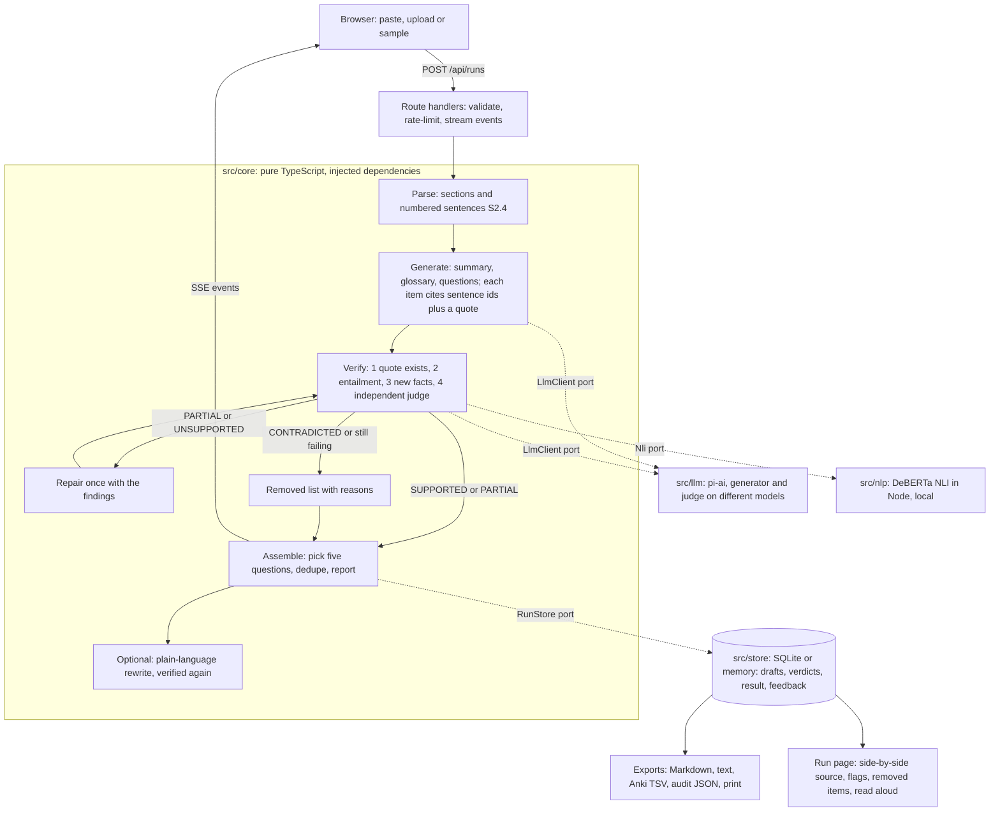

# NoteBridge

Turns **instructor-approved lecture notes** into a summary, a glossary and five practice questions, where **every item is tied to the exact source sentences it came from**, independently checked, and flagged or removed if the notes cannot support it.

It is a TypeScript / Next.js app. The model sees only numbered source sentences; a separate verifier checks every item four ways before it can be shown as supported; and nothing is dropped silently.

- Behaviour spec and sample data: [`Q9_Accessible_Lecture_Notes_Design.md`](Q9_Accessible_Lecture_Notes_Design.md)
- Conventions, invariants and stack: [`CLAUDE.md`](CLAUDE.md)
- Build history and decisions: [`STAGE.md`](STAGE.md)
- Measured accuracy: [`eval/RESULTS.md`](eval/RESULTS.md)
- Demo runsheet and viva answers: [`docs/DEMO.md`](docs/DEMO.md)

## What it guarantees (and what it does not)

1. **Nothing is shown as Supported unless four checks ran and passed**: the quote exists in the cited sentence, an entailment model agrees, no number or name appears that the notes never state, and a second, independent reviewer agrees. If a check cannot run (model missing, provider down) the item is at best *partial*, and the page says the verifier is degraded.
2. **Nothing disappears silently.** Every removed draft is listed with the check that failed; the run report's counts must add up.
3. **Your notes stay on the server and out of the logs.** No analytics, no third-party requests, API keys never reach the browser. Runs are deleted on request and expire automatically.
4. **It is not an oracle.** The verifier makes mistakes; the measured rates are below and in `eval/RESULTS.md`. Flagged items must be checked against the source.

## Quickstart

Needs **Node 22.19 or later** and npm.

```bash
npm install
npm run dev            # http://localhost:3000, demo mode
```

With no configuration the app starts in **demo mode**: scripted model output that reproduces the lore's sample (`fixtures/lecture7.md`), so it needs no keys and no downloads. Press *Use sample lecture*, then *Make study aids*.

### Live mode (real models)

```bash
cp .env.example .env.local     # then edit it
npm run models:fetch           # one-off, about 190 MB into .cache/models
npm run dev
```

In `.env.local` set `LLM_MODE=live` and pick a provider profile with one flag, for example `LLM_PROFILE=openrouter` or `LLM_PROFILE=nararouter` (see `.env.example`: each profile is `<NAME>_BASE_URL`, `<NAME>_GEN_MODEL`, `<NAME>_JUDGE_MODEL`, `<NAME>_API_KEY`). Keep the generator and the judge on **different models**; the app warns if they are the same. `npx tsx scripts/llm-smoke.ts` checks that both roles answer.

A run on a free model takes minutes (the sample lecture took about 12 minutes on a free router), not seconds.

### Docker

```bash
docker build -t notebridge .
docker run --rm -p 3000:3000 -v notebridge-data:/app/data \
  -e LLM_MODE=live -e LLM_PROFILE=openrouter -e OPENROUTER_API_KEY=... \
  -e OPENROUTER_GEN_MODEL=... -e OPENROUTER_JUDGE_MODEL=... notebridge
```

The image bakes in both local models and sets `NOTERISER_OFFLINE=1`, so it never downloads anything at run time. It is a long-running server, not a serverless function: the entailment model is about 160 MB and has to stay loaded. (The Dockerfile has not been built on the machine this was developed on; see the residual risks in `STAGE.md`.)

## Commands

| | |
|---|---|
| `npm run dev` / `build` / `start` | the app (stop `dev` before `e2e`: both use `.next`) |
| `npm run check` | typecheck + Biome + unit tests (no network, no keys) |
| `npm run test:slow` | tests against the real entailment model |
| `npm run e2e` | Playwright against a production build in demo mode, including axe, keyboard, print, security |
| `npm run eval -- --judge=fake` | verifier evaluation on the labelled dev cases, offline |
| `npm run eval:ci` | regression check (offline, a few seconds) |
| `npm run eval:sweep` / `eval:report` | threshold sweep (dev split only) and `eval/RESULTS.md` |
| `npm run eval:e2e` / `eval:kappa` | pipeline evaluation sheet for two human reviewers, and its κ |
| `npm run feedback:export` | instructors' feedback as candidate regression cases |
| `npx tsx scripts/run.ts <file> [--fake]` | the whole pipeline from the command line |

## Settings (environment)

| variable | meaning |
|---|---|
| `LLM_MODE` | `fake` (default) or `live` |
| `LLM_PROFILE`, `GEN_PROFILE`, `JUDGE_PROFILE` | which provider profile to use, for both roles or one |
| `RUN_TTL_HOURS` | how long runs are kept (default 24) |
| `MAX_SENTENCES`, `MAX_LLM_CALLS`, `MAX_COST_USD`, `RUN_TIMEOUT_MINUTES` | per-run caps (defaults 600, 800, 2, 30); a run that passes one stops and says which |
| `RATE_LIMIT_RUNS`, `RATE_LIMIT_WINDOW_MINUTES` | runs allowed per address per window (6 per 10 minutes) |
| `NOTERISER_DB` | where live runs are stored (default `data/noteriser.db`) |
| `NOTERISER_OFFLINE` | `1` forbids model downloads |

## Architecture



`src/core` imports nothing from Next, React, the model libraries or the database; those are adapters behind ports (`tests/architecture.test.ts` enforces it). That is what lets the whole pipeline run against scripted fakes in tests.

## How to read a run

- **Supported** (green tick): all four checks passed. **Check against source (partial)** (warning sign, with the reason in words): some check was inconclusive or objected to part of the claim. Never colour alone: every status is an icon *and* words.
- **Source references** such as `S2.4` are buttons: they highlight the cited sentence in the Source column (or open it under the item on a narrow screen).
- **Removed items** lists every draft that was not shown, why (not supported, contradicted by the notes, duplicate, or simply not needed because five questions were already chosen), and the checks that failed.
- **Run report**: sentences and sections found; items generated; accepted / partial / removed; summary coverage (share of sections with at least one point); repairs that helped; tokens and cost. The last line says whether the counts reconcile: generated = supported + partial + removed.
- A red **verifier degraded** banner means some check could not run; those items are not verified.
- **Reading level** (if you ticked plain language): switches between the notes' wording and plain-language versions that passed the same four checks; the page states how many were kept as written and why.

## Measured accuracy (summary)

From `eval/RESULTS.md`: 24 original lecture excerpts, 144 labelled drafts, split dev/test by a fixed rule. With a live judge on the **test** split: **no planted error reached Supported** (recall 100%, 36 of 36; 92% rejected outright), but the verifier **flagged 28% of good drafts** (target 15%, missed) and deleted 11% outright. Thresholds could not fix that; the report says what would. Labels were written by the same author as the cases, and the human-reviewed end-to-end metrics (faithfulness, κ) have **not** been measured.

## Limitations

- Tables, equations, diagrams and images are not processed (they are flagged as "not processed").
- English only. Scanned PDFs are rejected (no OCR).
- The verifier can be wrong both ways; see above. Notes that contain an error will be summarised faithfully, errors included.
- It checks claims against the notes, not against the world.
- Free model providers rate-limit; a run can be slow or stop at the per-run caps.
- Anyone with a run's link can read or delete it (no accounts); only the browser that made the run can download its audit file.

## Layout

```
src/core      pure pipeline: schema, ingest, segment, generate, verify, repair, plain, pipeline, report, export
src/llm       the only place the model SDK is imported (adapter, fake)
src/nlp       local entailment and embedding models (adapter, fake)
src/store     SQLite and in-memory run stores, retention purge, JSONL export
src/app       Next.js routes, pages and request logic (app/server)
src/ui        React components, copy.ts (all user-facing strings), settings, read aloud
src/demo      scripted fakes for the sample lecture (demo mode, tests)
eval/         labelled cases, runner, sweep, CI check, report, review sheet, regressions
scripts/      CLI entry points
tests/ e2e/   unit/integration tests and Playwright tests
docs/         research notes, demo runsheet, screen-reader checklist
```
